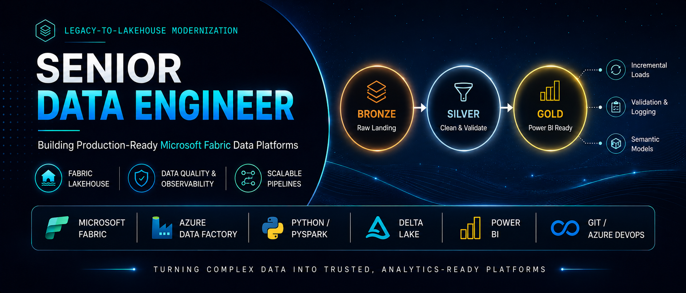

# 👋 Hi, I'm Bill Walker

## Senior Data Engineer | Microsoft Fabric | Azure Data Factory | Python/PySpark | Delta Lake | Power BI-Ready Data Products

I help modernize legacy SQL Server, SSIS, and Azure Data Factory-style data platforms into governed, production-ready lakehouse solutions using Microsoft Fabric, Python/PySpark, Delta Lake, Azure, Databricks, and Power BI.

---

## 🚀 About Me

I am a Senior Data Engineer with 18+ years of experience designing, building, modernizing, and supporting data platforms across traditional SQL Server environments and modern cloud lakehouse architectures.

My current focus is **legacy-to-lakehouse modernization**: helping teams move from SQL Server, SSIS, stored procedures, manual extracts, and fragmented reporting pipelines into scalable, validated, and business-ready data platforms.

I specialize in:

- Microsoft Fabric lakehouse architecture
- Azure Data Factory and metadata-driven ingestion (control tables, parameterized sources and targets)
- Python, PySpark, Spark SQL, and Delta Lake
- Bronze / Silver / Gold medallion architecture, with raw data preserved and every transformation traceable
- Incremental loading, MERGE/upsert logic, and watermark patterns
- Data validation, run logging, monitoring, rerun-safe design, and production support
- Power BI-ready Gold layers, semantic models, and analytics data products
- Git, CI/CD, Dev/Test/Prod promotion, and deployment discipline

What makes my background valuable is that I understand both sides of the modernization journey:

- the legacy SQL Server / SSIS / database systems many companies still rely on
- the modern Fabric / Azure / Databricks lakehouse platforms they are moving toward

---

## 🧭 My Data Engineering Focus

```text
Source Systems
  ↓
Ingestion Frameworks
  ↓
Bronze Raw Landing
  ↓
Silver Cleansed Data
  ↓
Gold Business Models
  ↓
Power BI Semantic Models
  ↓
Trusted Business Reporting
```

I focus on building data platforms that are not just functional, but production-ready:

- reusable
- observable
- validated
- documented
- rerunnable
- governed
- business-aligned

---

## 🧱 Featured Projects

### 🔹 Microsoft Fabric Modern Data Platform

Flagship Commercial Real Estate data engineering project demonstrating how legacy SQL, API, and file-based pipelines can be modernized into a governed Microsoft Fabric lakehouse architecture.

**Key patterns demonstrated:**

- Multi-source SQL-style, REST API, and file ingestion
- Bronze / Silver / Gold medallion architecture
- Python, pandas, PySpark, Delta Lake, and OneLake patterns
- Configuration-driven validation, quarantine, and deduplication
- Power BI-ready star schema and Direct Lake semantic model
- Governed DAX measures and semantic-model validation
- Dependency-aware orchestration, audit logging, and monitoring
- Automated testing with pytest and GitHub Actions
- Dev/Test/Prod release gates, packaging, and rollback planning

👉 [View Project](https://github.com/billpaulwalker/fabric-modern-data-platform)

---

### 🔹 REST API Data Ingestion → Microsoft Fabric Lakehouse  
**Python + GitHub REST API + Delta Lake + OneLake**

End-to-end incremental ingestion pipeline that loads GitHub issues and pull requests into Delta tables in a Microsoft Fabric Lakehouse. The same code runs locally, in CI, or in a Fabric notebook.

**Key patterns demonstrated:**

- Bearer-token auth from environment / Azure Key Vault, with no committed secrets
- `Link`-header pagination with a runaway-loop guardrail
- Server-side incremental loads (`since=`) with a separate watermark per source, stored in Delta
- Retries with exponential backoff, `Retry-After` support, and proactive rate-limit throttling
- Bronze raw-page append → Silver `MERGE` on primary key, so reruns never duplicate data
- Watermark committed only after a successful load, so an interrupted run recovers by simply rerunning
- Run log table plus an Operations & Troubleshooting runbook (401s, 429s, interrupted runs, duplicates)
- Fabric Python notebook, Data pipeline orchestration, and SQL endpoint health checks
- 37 pytest tests against real Delta tables; GitHub Actions on Ubuntu and Windows

👉 [View Project](https://github.com/billpaulwalker/rest-api-data-ingestion)

---

### 🔹 Real-Time Lakehouse Pipeline  
**Databricks + PySpark + Delta Lake**

Streaming-first lakehouse project demonstrating modern distributed data engineering patterns.

**Key patterns demonstrated:**

- Databricks lakehouse architecture
- Structured Streaming
- Delta Lake
- Bronze / Silver / Gold pipeline design
- event-driven ingestion concepts
- checkpointing and schema handling
- PySpark transformations

👉 [View Project](https://github.com/billpaulwalker/databricks-realtime-lakehouse-pipeline)

---

### 🔹 Commercial Real Estate Analytics Engineering Platform  
**dbt + SQL + Dimensional Modeling**

Analytics engineering project focused on clean transformation design, testing, and business-ready data marts.

**Key patterns demonstrated:**

- dbt project structure
- staging, intermediate, and mart layers
- star schema modeling
- SQL transformations
- reusable macros
- data quality tests
- CI/CD integration
- commercial real estate reporting model

👉 [View Project](https://github.com/billpaulwalker/commercial-real-estate-dbt-platform)

---

## ⚙️ Core Tech Stack

**Microsoft & Azure:** Microsoft Fabric (Lakehouse, Warehouse, OneLake) · Azure Data Factory · Azure Synapse Analytics · Azure SQL · ADLS Gen2 · Azure Monitor · Power BI · Direct Lake

**Data Engineering:** Python · PySpark · Spark SQL · SQL / T-SQL · pandas · Delta Lake · Databricks · dbt · REST APIs / JSON

**Production Engineering:** Git · GitHub Actions · CI/CD · pytest · Dev/Test/Prod deployment · logging, monitoring & alerting · data quality checks

**Data Modeling & BI:** dimensional modeling · star schema design · semantic models · reporting data marts

---

## 📌 Current Learning & Build Focus

I am continuing to deepen my hands-on work across:

- Microsoft Fabric production patterns
- Python and PySpark for data engineering
- REST API ingestion frameworks
- Azure Data Factory to Fabric modernization
- Databricks lakehouse engineering
- Power BI semantic model readiness
- Git / Azure DevOps deployment practices

---

## 🤝 Let's Connect

- 💼 LinkedIn: https://linkedin.com/in/billpaulwalker
- 📧 Email: billpaulwalker@gmail.com

---

## ⚡ Professional Philosophy

Modern data engineering is not just about moving data.

It is about building trusted, scalable, observable, and business-ready data platforms that help teams make better decisions.
